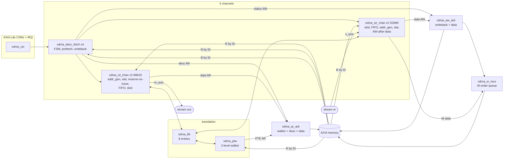
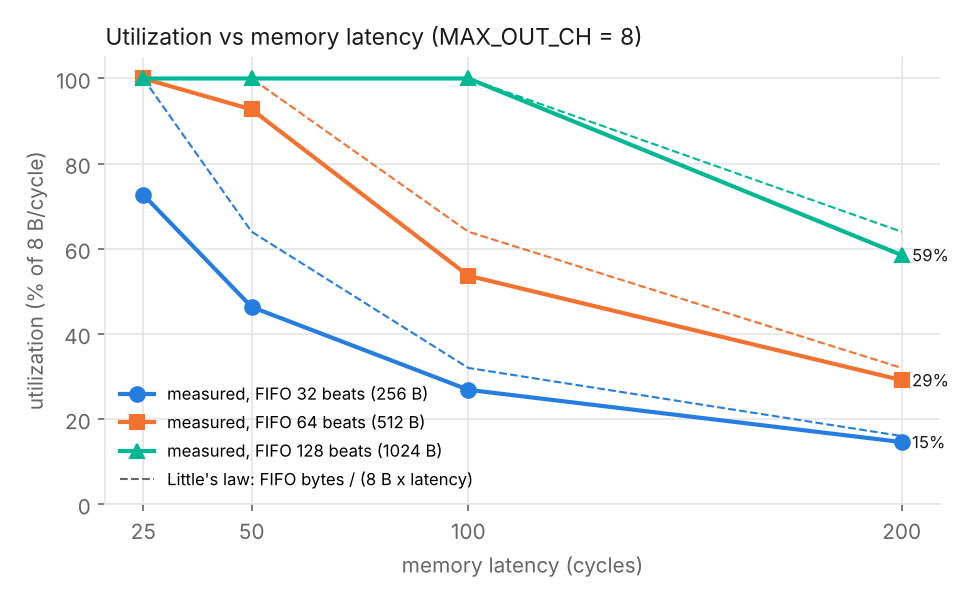

# XDMA: a multi-channel scatter-gather DMA engine

XDMA moves data between AXI4 memory and AXI4-Stream ports, driven by linked
lists of 1D/2D descriptors in memory, with optional Sv32-style address
translation. It is written in synthesizable SystemVerilog and verified with
a constrained-random cocotb testbench, SystemVerilog assertions and formal
proofs. It is synthesized on the ASAP7 7 nm predictive PDK.

- **Spec:** [SPEC.md](SPEC.md)
- **Design walkthrough (interview prep):** [docs/DESIGN_WALKTHROUGH.md](docs/DESIGN_WALKTHROUGH.md)
- **Results:** [results/RESULTS.md](results/RESULTS.md)
- **Decisions and bug stories:** [docs/DECISIONS.md](docs/DECISIONS.md)
- **Known limitations and next steps:** [docs/FUTURE.md](docs/FUTURE.md)

## Block diagram



## Features

- 2 MM2S + 2 S2MM channels; MM2S looped into S2MM gives a memory copy.
- 32-byte linked-list descriptors: 1D or 2D (LINE_BYTES × LINES, signed
  STRIDE), per-descriptor IRQ and end-of-packet, status writeback.
- AXI4 master: 64-bit data, INCR bursts up to 16 beats, never across a 4 KB
  boundary, up to 16 reads and 8 writes outstanding.
- Reserve-on-issue reads: RREADY is never deasserted.
- AW-after-data writes: a stalled stream source can't block the shared W
  channel. W never waits for AWREADY.
- Arbitration: fixed priority for walker and descriptor traffic,
  round-robin among data channels.
- Optional translation: 8-entry fully associative TLB with hit-under-miss,
  and a two-level page-table walker with permission and megapage faults.
  The TLB flush is safe against in-flight walks.
- Errors are contained per channel. Abort is supported from any state.
  There is one level interrupt.
- Hardware counters: cycles, bytes, busy and stall cycles, TLB hits and
  misses.

## Results

<!-- results:start -->
| Metric | Value | Source |
|---|---|---|
| Channels / data width / max burst | 4 (2 MM2S + 2 S2MM) / 64-bit / 16 beats | parameters (rtl/xdma_top.sv) |
| Outstanding transactions (engine-wide reads) | 16 (MAX_OUT_RD) | parameters |
| Bandwidth utilization at latency 50, defaults | 92.7% | `make perf` (perf_latency, steady state, hardware counters) |
| Bandwidth utilization at latency 200, FIFO 128 | 58.5% | `make perf` |
| TLB hit rate, linear 64 KB transfer | 96.9% (496 hits, 16 misses) | `make perf` (perf_xlat) |
| Achieved clock (Yosys + OpenSTA, ASAP7, post-synthesis) | 1.00 GHz (1000 ps, WNS +46.1 ps) | `make syn` |
| Standard-cell area | 17,025 µm² (clock gating off); 12,776 µm² (clock gating on) | `make syn` (Yosys stat, ASAP7 liberty) |
| Total power at target clock (perf_saturate activity) | 8.69 mW with clock gating, 37.96 mW without | `make syn` (OpenSTA, SAIF) |
| Regression | FIFO_DEPTH32_MAX_OUT_CH4_MAX_BURST8: 151/151 runs pass (16 tests, up to 10 seeds each); default: 401/401 runs pass (17 tests, up to 25 seeds each) | `make regress SEEDS=N` |
| Formal | 7/7 proofs pass (unbounded); 5/5 cover sets reached; w_mux proven at reduced size (2 writes in flight, 1-4 beat bursts), full size in simulation | `make formal` |
| Coverage | not run | `make cov` |

Generated by `make results`; details and sources in [results/RESULTS.md](results/RESULTS.md).
<!-- results:end -->

Plots (`make perf`):



## Design decisions (summary)

- **Reserve-on-issue (MM2S).** An AR is issued only if the FIFO has room for
  every beat in flight, so R data is always accepted. Stalling the shared R
  channel for one slow stream would block every other ID (head-of-line
  blocking).
- **AW-after-data (S2MM).** An AW is issued only once all its beats are in
  the FIFO. W data has no ID and leaves in AW order, so an AW issued ahead
  of its data would block W for everyone if the stream stalled.
- **AXI ID map.** Data uses ID c, descriptor fetch and writeback use
  NUM_CH + c, and the walker uses 2·NUM_CH. Control traffic never waits
  behind data on the same ID, and responses are routed by ID alone.
- **Bursts never cross 4 KB.** This is an AXI4 rule, and because pages are
  4 KB it also means each burst needs exactly one translation.
- **Little's-law FIFO sizing.** Sustaining 8 B/cycle at latency L needs
  about 8 × (L + 19) bytes in flight, and with reserve-on-issue the FIFO
  must hold them. Measured: 92.7% at L = 50 with a 512 B FIFO, 29% at
  L = 200; a 1 KB FIFO keeps 100% up to L = 100. Details in the walkthrough.

Every decision and every bug found, with how it was found, is in
[docs/DECISIONS.md](docs/DECISIONS.md).

## Running it

Toolchain (open source, see [docs/ENV.md](docs/ENV.md)): Verilator 5.054,
cocotb 2.1, SymbiYosys with yosys-slang and Yices/ABC, Yosys + OpenSTA with
ASAP7.

```sh
sudo ./tools/setup_tools.sh        # once: builds/installs the tools
source tools/env.sh                # every shell
```

| Target | Does |
|---|---|
| `make lint` | Verilator `-Wall` (justified waivers in `tools/lint/`) and a second front end (slang) |
| `make sim` | every test once (`TEST=<name> SEED=<n> WAVES=1` for one test with FST waves) |
| `make regress SEEDS=200` | every random test across N seeds, in parallel |
| `make cov` | line, toggle and assertion-cover coverage plus functional coverage |
| `make formal` | all SymbiYosys proofs and covers, summary table |
| `make perf` | performance sweeps, CSVs and PNG plots in `perf/out/` |
| `make syn` | Yosys + OpenSTA on ASAP7: clock sweep, area per block, power with and without clock gating |
| `make gls` | gate-level simulation of the loopback copy on the synthesized netlist |
| `make results` | regenerate `results/RESULTS.md` (and the table above) from all of the above |

A failing random test prints its seed and the exact `make sim` command that
reproduces it.

## Repository layout

```
rtl/          SystemVerilog design (one module per file)
sva/          assertion modules + bind file (simulation and formal)
tb/           cocotb tests, Python models (memory, reference, page tables,
              descriptor generator), scoreboard, runner, regression
formal/sby/   SymbiYosys targets; formal/run_formal.py summarizes them
perf/         performance sweep driver (outputs in perf/out/)
syn/          ASAP7 fetch script, Yosys/OpenSTA flow, gate-level sim models
results/      RESULTS.md and plots (generated)
docs/         ENV, PROGRESS, DECISIONS, FUTURE, DESIGN_WALKTHROUGH
tools/        tool setup, environment, lint, results generator
```

## Known limitations

- Numbers are post-synthesis with an ideal clock: no place and route, no
  clock tree, no wire parasitics.
- The commercial flow in the spec (VCS, JasperGold, Design Compiler,
  PrimeTime) was not available. Everything here uses open-source tools. The
  RTL stays within constructs Design Compiler accepts.
- The inter-descriptor gap is one writeback round trip plus one first-read
  latency (the section 7.1 state machine). See FUTURE.md for overlapping
  them, and for the other items left out on purpose.
