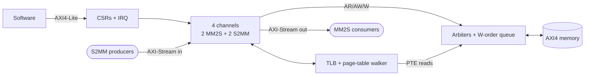
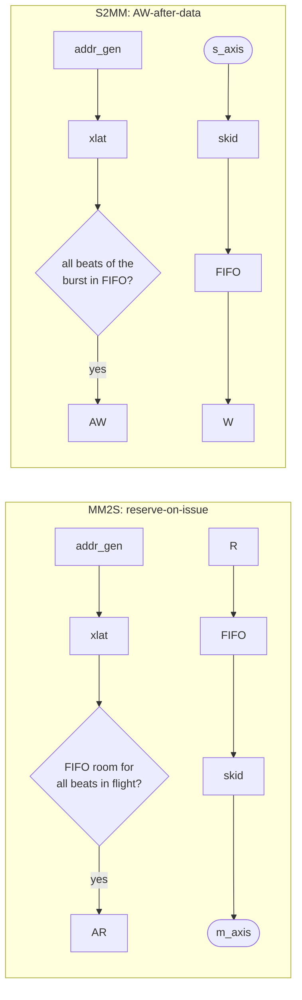
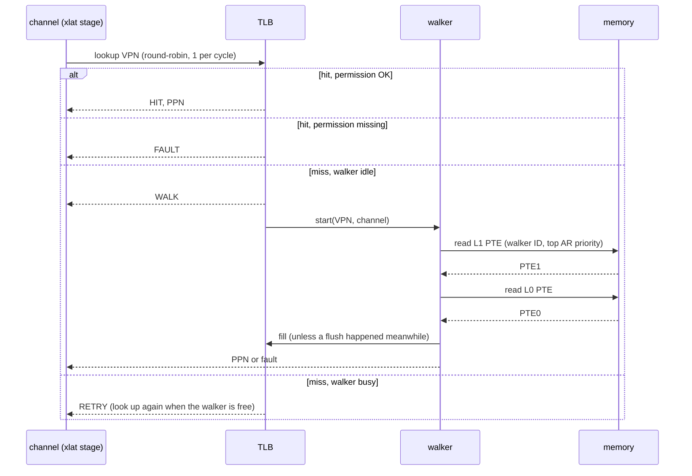

# XDMA: Multi-Channel Scatter-Gather DMA Engine — Implementation Spec

Owner: Rohan Rao. Status: v1.1, 2026-11-26 (changes from v1 are listed in the changelog at the end).

This document is the requirement for the design in this repository. Where it is silent, the simplest correct option was chosen and recorded in `docs/DECISIONS.md`. Every number in `results/RESULTS.md` comes from a script in this repo that anyone can re-run.

---

## 1. What we are building

XDMA moves data between AXI4 memory and AXI4-Stream ports, driven by linked lists of descriptors in memory.

- **4 channels:** 2 MM2S (memory-to-stream, read) and 2 S2MM (stream-to-memory, write). A memory-to-memory copy is an MM2S channel looped into an S2MM channel.
- **Descriptors:** 32-byte, linked-list ("scatter-gather"), each describing a 1D or 2D strided region.
- **AXI4 master:** 64-bit data, 32-bit address, INCR bursts up to 16 beats, never crossing a 4 KB boundary, multiple outstanding transactions.
- **Arbitration:** round-robin among channels, with fixed priority for descriptor and page-table traffic.
- **Address translation:** optional per engine. 8-entry fully associative TLB, two-level page-table walker (Sv32-style, 4 KB pages).
- **Control:** AXI4-Lite CSRs, one level-sensitive interrupt.



### Explicit non-goals (do not implement)

Real-time QoS, weighted arbitration, unaligned addresses or lengths, byte-granular lengths, megapages/superpages, multiple outstanding page walks, multiple AXI IDs per channel for data, a reorder buffer, multiple clock domains, data-width conversion, compression, tiled formats, interrupt coalescing. If tempted, add it to `docs/FUTURE.md` instead.

---

## 2. Deliverables and repo layout

### 2.1 Toolchain

The design was built and verified with an open-source flow (the commercial flow in v1 was not available; see the changelog):

| Purpose | Tool |
|---|---|
| Simulation | Verilator (assertions enabled), FST waves |
| Testbench | cocotb (Python models and tests); cocotbext-axi for the AXI4-Lite master and stream sinks |
| Lint | Verilator `--lint-only -Wall` with justified waivers, plus a full elaboration by slang (through Yosys) |
| Formal | SymbiYosys: yosys-slang front end, Yices k-induction / BMC, ABC PDR |
| Synthesis | Yosys (ABC mapping with buffering and sizing) onto ASAP7 RVT, typical corner |
| Timing and power | OpenSTA; activity from simulation as SAIF |

The RTL stays within constructs Synopsys Design Compiler, VCS and JasperGold accept, so the same sources can be run through a commercial flow. ASAP7 collateral is fetched by a script, never committed.

### 2.2 Repo layout

```
xdma/
  rtl/                 SystemVerilog sources (section 13)
  sva/                 assertion modules + bind file (simulation and formal)
  tb/                  cocotb tests, runner, regression, scoreboard
    models/            ref_model.py, axi_mem.py, page_table.py, desc_builder.py
    hdl/               simulation wrapper (xdma_tb)
  formal/sby/          one SymbiYosys file per proof target
  syn/yosys/           ASAP7 fetch, Yosys synthesis, OpenSTA timing and power
  syn/gls/             cell models for gate-level simulation
  perf/                performance sweep driver
  results/RESULTS.md   final numbers (section 18), plots
  docs/                ENV, PROGRESS, DECISIONS, FUTURE, DESIGN_WALKTHROUGH
  tools/               setup, environment, lint, results generator
  Makefile             top-level targets (below)
  README.md
```

Top-level make targets, each runs from a clean checkout after `source tools/env.sh`:

| Target | Does |
|---|---|
| `make lint` | Verilator `-Wall` and slang; zero warnings outside the justified waiver file |
| `make sim` | every cocotb test once; `TEST=<name> SEED=<n> WAVES=1` for one test with waves |
| `make regress SEEDS=200` | all random tests across N seeds |
| `make cov` | line, toggle and assertion-cover coverage plus functional coverage |
| `make formal` | all proofs; summary of proven / bounded / failed |
| `make syn` | synthesis on ASAP7, clock sweep, area, timing and power |
| `make gls` | gate-level simulation of `test_loopback_copy` on the netlist |
| `make perf` | performance sweeps, CSVs and PNG plots into `perf/out/` |
| `make results` | regenerates `results/RESULTS.md` from the above outputs |

---

## 3. Parameters

| Name | Default | Notes |
|---|---|---|
| `NUM_MM2S` | 2 | MM2S channels are channel indices 0..NUM_MM2S-1 |
| `NUM_S2MM` | 2 | S2MM channels follow: NUM_MM2S..NUM_CH-1 |
| `NUM_CH` | 4 | Derived |
| `ADDR_W` | 32 | Virtual and physical addresses are both 32 bits |
| `DATA_W` | 64 | Bytes per beat `BPB` = 8 |
| `ID_W` | 4 | See AXI ID map (section 9.1) |
| `MAX_BURST` | 16 | Beats; 128 bytes max per burst |
| `FIFO_DEPTH` | 64 | Beats per channel data FIFO (512 B) |
| `MAX_OUT_CH` | 8 | Max outstanding data bursts per channel |
| `MAX_OUT_RD` | 16 | Max outstanding AR transactions, engine-wide |
| `MAX_OUT_WR` | 8 | Max outstanding AW transactions, engine-wide |
| `TLB_ENTRIES` | 8 | Fully associative |

All parameters must be overridable from the testbench. Tests must pass at defaults and at `FIFO_DEPTH=32, MAX_OUT_CH=4, MAX_BURST=8`.

---

## 4. Top-level interface (`xdma_top`)

Single clock `clk`, active-low synchronous reset `rst_n`. All AXI signals use standard AMBA names.

| Group | Direction | Signals |
|---|---|---|
| Clock/reset | in | `clk`, `rst_n` |
| CSR | slave | `s_axil_aw{valid,ready,addr[11:0]}`, `s_axil_w{valid,ready,data[31:0],strb[3:0]}`, `s_axil_b{valid,ready,resp[1:0]}`, `s_axil_ar{valid,ready,addr[11:0]}`, `s_axil_r{valid,ready,data[31:0],resp[1:0]}` |
| Memory | master | `m_axi_aw{valid,ready,id,addr,len[7:0],size[2:0],burst[1:0],cache[3:0],prot[2:0],lock,qos[3:0]}`, `m_axi_w{valid,ready,data,strb,last}`, `m_axi_b{valid,ready,id,resp}`, `m_axi_ar{...same as aw}`, `m_axi_r{valid,ready,id,data,resp,last}` |
| MM2S streams | master, x NUM_MM2S | `m_axis_tvalid`, `m_axis_tready`, `m_axis_tdata[63:0]`, `m_axis_tkeep[7:0]` (always all ones), `m_axis_tlast` |
| S2MM streams | slave, x NUM_S2MM | `s_axis_tvalid`, `s_axis_tready`, `s_axis_tdata[63:0]`, `s_axis_tkeep[7:0]` (must be all ones; otherwise error), `s_axis_tlast` |
| Interrupt | out | `irq` (level, active high) |

Stream ports are packed arrays, e.g. `m_axis_tdata[NUM_MM2S][63:0]`.

Fixed AXI field values: `size = 3'b011` (8 bytes), `burst = 2'b01` (INCR), `cache = 4'b0011`, `prot = 3'b000`, `lock = 0`, `qos = 0`. `WSTRB` is all ones except for the 8-byte descriptor status writeback, which uses a full-beat write (section 7.3).

**AXI rules every master output must obey:** once VALID is high, it stays high and the payload is stable until READY. No combinational path from any READY input to any VALID output. Register every AXI and AXI-Stream output through a skid buffer (`xdma_skid`).

---

## 5. Register map (AXI4-Lite, 32-bit, byte addresses)

Unmapped reads return 0; unmapped writes are ignored. All responses OKAY. Access: RO read-only, RW read/write, W1C write-1-to-clear, W1S write-1-to-set (self-clearing pulse).

### 5.1 Global registers

| Offset | Name | Access | Fields |
|---|---|---|---|
| 0x000 | ID | RO | `0x58444D41` ("XDMA") |
| 0x004 | CAPS | RO | [3:0] NUM_MM2S, [7:4] NUM_S2MM, [15:8] MAX_BURST, [23:16] TLB_ENTRIES, [31:24] DATA_W/8 |
| 0x008 | GCTRL | RW / W1S | [0] TRANSLATE_EN (RW); [1] TLB_FLUSH (W1S) |
| 0x00C | PT_ROOT | RW | [19:0] physical page number of the level-1 page table |
| 0x010 | IRQ_STATUS | W1C | [c] channel c DONE; [8+c] channel c ERROR |
| 0x014 | IRQ_MASK | RW | Same layout; `irq = |(IRQ_STATUS & IRQ_MASK)` |
| 0x018 | CYCLES | RO | Free-running cycle counter (lower 32 bits) |
| 0x01C | TLB_STATS | RO | [15:0] hits, [31:16] misses (saturating) |

TRANSLATE_EN and PT_ROOT may only be changed while every channel is idle; behavior otherwise is undefined (document this, don't handle it).

### 5.2 Per-channel registers (base = 0x100 + 0x40 × c)

| Offset | Name | Access | Fields |
|---|---|---|---|
| +0x00 | CTRL | RW / W1S | [0] EN (RW); [1] START (W1S); [2] ABORT (W1S) |
| +0x04 | DESC_HEAD | RW | Physical address of first descriptor, 32-byte aligned |
| +0x08 | STATUS | RO | [0] BUSY; [3:1] ERR code (section 10); [31:8] descriptors completed (wraps) |
| +0x0C | CUR_DESC | RO | Physical address of the descriptor being executed |
| +0x10 | ERR_ADDR | RO | Address that caused the last error (VA for translation faults) |
| +0x14 | BYTES | RO | Bytes moved since START (wraps) |
| +0x18 | BUSY_CYC | RO | Cycles with BUSY = 1 |
| +0x1C | STALL_CYC | RO | Cycles the channel had a request ready but was not granted, or was blocked on FIFO space / stream backpressure |

START is ignored unless EN = 1 and the channel is idle. Starting a channel clears its ERR field and its counters.

---

## 6. Descriptor format

32 bytes, 32-byte aligned, little-endian, in **physical** memory (descriptors are never translated). Four 64-bit words:

| Word (byte offset) | Bits | Field | Meaning |
|---|---|---|---|
| 0 (0x00) | [31:0] | NEXT | Physical address of next descriptor (32-byte aligned). Ignored if CTRL.LAST |
| 0 (0x00) | [63:32] | ADDR | Address of line 0: source for MM2S, destination for S2MM. Virtual if TRANSLATE_EN, else physical |
| 1 (0x08) | [15:0] | LINE_BYTES | Bytes per line. Multiple of 8, nonzero |
| 1 (0x08) | [31:16] | LINES | Number of lines, nonzero. 1 = plain 1D transfer |
| 1 (0x08) | [63:32] | STRIDE | Signed byte offset from one line start to the next. Multiple of 8 |
| 2 (0x10) | [0] | CTRL.LAST | Stop after this descriptor |
| 2 (0x10) | [1] | CTRL.IRQ | Set the channel's DONE interrupt bit on completion |
| 2 (0x10) | [2] | CTRL.EOP | End of packet: MM2S asserts TLAST on the final beat; S2MM expects TLAST on the final beat |
| 2 (0x10) | [63:3] | reserved | Must be zero; ignored |
| 3 (0x18) | [0] | STATUS.DONE | Written by the engine on completion |
| 3 (0x18) | [3:1] | STATUS.ERR | Written by the engine (section 10) |
| 3 (0x18) | [63:32] | STATUS.BYTES | Bytes transferred for this descriptor |

**Validation on fetch:** ADDR, LINE_BYTES and STRIDE must be multiples of 8; LINE_BYTES and LINES nonzero; NEXT 32-byte aligned unless LAST. Any violation is error DESC_INVALID; nothing from that descriptor is transferred.

**Stream semantics.** MM2S emits all lines back to back as one stream; TLAST is asserted only on the final beat of a descriptor with EOP = 1, never elsewhere. S2MM consumes exactly LINE_BYTES × LINES / 8 beats per descriptor. If EOP = 1, TLAST must arrive on exactly the last beat; if EOP = 0, TLAST must not arrive during the descriptor. Any mismatch is error STREAM_LEN.

---

## 7. Channel operation

### 7.1 Channel state machine

```mermaid
stateDiagram-v2
  [*] --> IDLE
  IDLE --> FETCH: START (EN = 1)
  FETCH --> RUN: descriptor valid
  FETCH --> IDLE: fetch error / invalid (ERR set, no writeback)
  RUN --> WRITEBACK: all data done
  RUN --> DRAIN: error / ABORT
  WRITEBACK --> FETCH: !LAST (next = NEXT; usually already prefetched)
  WRITEBACK --> IDLE: LAST (DONE irq if CTRL.IRQ)
  DRAIN --> IDLE: outstanding == 0, error status written back (ERR set)
```



- **FETCH:** one AR for 32 bytes (4 beats, ARLEN = 3) at the descriptor address, using the channel's descriptor ID (section 9.1).
- **Prefetch:** while in RUN, the fetcher may fetch the next descriptor (if the current one is not LAST) into a one-entry shadow register. This is required. Prefetch hides descriptor fetch latency. The remaining inter-descriptor gap (status writeback round trip + first read latency) is measured by the descriptor-overhead experiment and reported in RESULTS.md.
- **RUN completes** for MM2S when every R beat of the descriptor has been accepted by the stream port; for S2MM when every B response for the descriptor has returned OKAY.
- **WRITEBACK:** one AW + one W beat (full 64-bit beat, WSTRB = 0xFF) to word 3 (offset 0x18) with DONE, ERR and BYTES; wait for B. The channel does not report DONE until this B returns.
- **DRAIN:** stop issuing new requests. Wait for every outstanding AR/AW of this channel to complete (AXI transactions cannot be cancelled). MM2S discards drained R data; S2MM drops TREADY and discards FIFO contents after all B responses return. Then write back the error status to the descriptor if the error is not on the descriptor fetch itself, set ERR, raise the ERROR interrupt bit, go IDLE.

### 7.2 Address generation and burst splitting (`xdma_addr_gen`)

One instance per channel. Exact algorithm (all quantities in bytes; all are multiples of 8):

```
line_addr = ADDR
for y in 0 .. LINES-1:
    off = 0
    while off < LINE_BYTES:
        a      = line_addr + off
        to_4k  = 4096 - (a mod 4096)
        bytes  = min(MAX_BURST * 8, LINE_BYTES - off, to_4k)
        emit burst(addr = a, beats = bytes / 8, last_of_desc = (y == LINES-1 and off + bytes == LINE_BYTES))
        off   += bytes
    line_addr = line_addr + STRIDE      # running add, no multiplier
```

- Output is a valid/ready stream of `{va, beats, last_of_desc}`; one burst per cycle at most.
- Address arithmetic wraps at 2^32; wrapping is not an error.
- Because 4 KB is the page size, every burst lies in exactly one page, so each burst needs exactly one translation.

### 7.3 MM2S data path (`xdma_rd_chan`)

1. Burst from addr_gen → translation (section 8) → physical burst request.
2. **Reserve-on-issue:** the channel may present an AR only if `fifo_free - reserved >= beats` and its outstanding count `< MAX_OUT_CH`. On AR handshake, `reserved += beats`, `outstanding += 1`.
3. R beats with this channel's data ID are written to the channel FIFO (`reserved -= 1` per beat, so `fifo_free` and `reserved` stay consistent). On RLAST, `outstanding -= 1`.
4. FIFO → skid buffer → `m_axis`. TLAST per section 6. Count bytes.
5. The read side must never deassert RREADY because a FIFO is full; reservation guarantees space. Assert this.

Why reserve-on-issue: R data for one ID cannot be refused without stalling the shared R channel for every channel (head-of-line blocking). Document this in `docs/DECISIONS.md`.

### 7.4 S2MM data path (`xdma_wr_chan`)

1. `s_axis` → channel FIFO (TREADY = FIFO not full and channel in RUN and not in error). Check TKEEP all ones and TLAST rules; violations raise STREAM_LEN.
2. Burst from addr_gen → translation → physical burst request.
3. **Issue AW only when the data is already there:** present AW only if `fifo_count - committed >= beats` and outstanding `< MAX_OUT_CH`. When the AW arbiter accepts the request, `committed += beats` and `{channel, beats}` is pushed into the engine-wide W-order queue. (Pushing at acceptance, not at the bus AW handshake, matters: AXI4 forbids a master from waiting for AWREADY before asserting WVALID.)
4. The W mux (`xdma_w_mux`) pops the head of the W-order queue and streams exactly `beats` beats from that channel's FIFO, WLAST on the final one, then `committed -= beats`. AXI4 forbids write-data interleaving, so W beats leave in AW order.
5. Count B responses per descriptor; the descriptor completes when all its B responses are back.

Why AW-after-data: if AW went first and stream data stalled, the W channel would be blocked for every other channel. Document this too.



---

## 8. Address translation

### 8.1 Model (Sv32-style, simplified)

- 32-bit VA = VPN1[31:22] | VPN0[21:12] | offset[11:0]. 4 KB pages only.
- PTE is 32 bits: [31:10] PPN (only [29:10] = 20 bits used; PA = {PPN[19:0], offset}), [3] X, [2] W, [1] R, [0] V. Other bits ignored.
- Level-1 PTE address = (PT_ROOT << 12) + VPN1 × 4. If V = 0 → fault. If R|W|X != 0 at level 1 (a megapage) → fault (unsupported). Otherwise next table PPN = PTE.PPN.
- Level-0 PTE address = (PPN << 12) + VPN0 × 4. If V = 0 → fault. Leaf must have R = 1 for MM2S, W = 1 for S2MM, else fault.
- Page tables live in physical memory. PTE reads are single-beat AXI reads (ARLEN = 0) of the aligned 8-byte word; select the 32-bit half with address bit 2.

### 8.2 TLB (`xdma_tlb`)

- 8 entries, fully associative: `{valid, vpn[19:0], ppn[19:0], r, w}`.
- One lookup per cycle, shared by all channels through a round-robin request arbiter. Lookup result is registered (1-cycle latency).
- Replacement: round-robin pointer (simple and adequate; note pseudo-LRU in FUTURE.md).
- TLB_FLUSH clears all valid bits.
- A hit with insufficient permission is a fault (no walk).
- Count hits and misses in TLB_STATS.

### 8.3 Page-table walker (`xdma_ptw`)

- One walk at a time. While a walk is in progress, other channels' lookups continue (hit-under-miss); a second miss waits for the walker.
- Walker reads use the walker AXI ID and have highest AR priority.
- On success, fill the TLB and return the translation to the waiting channel. On fault, return a fault to that channel only: that channel goes to DRAIN with error XLAT_FAULT and ERR_ADDR = faulting VA.
- Walker AXI error response (SLVERR/DECERR) is also XLAT_FAULT.

When TRANSLATE_EN = 0, translation is a 0-cycle bypass (PA = VA).

A TLB_FLUSH must also cancel any walk in flight: a walk that saw a flush does not fill the TLB and its channel looks up again; a lookup compared in the flush cycle does not hit.



---

## 9. Arbitration and AXI IDs

### 9.1 AXI ID map (ID_W = 4)

| ID | Use |
|---|---|
| 0..NUM_CH-1 | Data bursts of channel c (AR for MM2S, AW for S2MM) |
| NUM_CH..2·NUM_CH-1 (4..7 at defaults) | Descriptor fetch (AR) and status writeback (AW) of channel c |
| 2·NUM_CH (8 at defaults) | Page-table walker (AR) |

ID_W must hold 2·NUM_CH.

Separate IDs keep descriptor and walker reads from queuing behind data on the same ID. Route R and B responses by ID.

### 9.2 AR arbiter

Fixed priority between classes, round-robin inside a class:
1. Walker
2. Descriptor fetches (round-robin across channels)
3. MM2S data bursts (round-robin across MM2S channels)

Also enforce `MAX_OUT_RD` outstanding ARs engine-wide.

### 9.3 AW arbiter

1. Status writebacks (round-robin across channels)
2. S2MM data bursts (round-robin across S2MM channels)

Enforce `MAX_OUT_WR`. Writebacks also enter the W-order queue (1 beat from a writeback holding register, not a FIFO).

### 9.4 Round-robin arbiter (`xdma_rr_arb`)

Parameterized N requesters, one-hot grant, rotating priority pointer that advances past the winner only on a handshake. Must be starvation-free: any requester held high is granted within N handshakes. Prove this formally (section 15).

---

## 10. Errors and interrupts

| Code | Name | Cause |
|---|---|---|
| 0 | NONE | — |
| 1 | DESC_INVALID | Descriptor field violates section 6 validation |
| 2 | DESC_FETCH | SLVERR/DECERR on a descriptor read |
| 3 | RD_RESP | SLVERR/DECERR on an MM2S data read |
| 4 | WR_RESP | SLVERR/DECERR on an S2MM data write or status writeback |
| 5 | XLAT_FAULT | Translation fault or walker error |
| 6 | STREAM_LEN | S2MM TLAST/TKEEP rule violated |
| 7 | ABORTED | Software ABORT |

An error affects only its channel; other channels continue unaffected (test this). Interrupts: section 5.1.

---

## 11. Performance counters

Implement CYCLES, TLB_STATS and the per-channel BYTES, BUSY_CYC, STALL_CYC as specified. Bandwidth in `make perf` is computed from these hardware counters and cross-checked against testbench timestamps (must agree within 1%).

---

## 12. Power

- Use enable-style coding on all wide datapath registers (FIFOs, skid buffers, descriptor registers) so synthesis can infer clock gating.
- Report PrimeTime PX power with Design Compiler clock-gating inference on vs. off, at measured activity (SAIF from the `perf_saturate` test) and at idle.

---

## 13. RTL modules and coding rules

| File | Module | Contents |
|---|---|---|
| `xdma_pkg.sv` | package | Parameters, types, error codes, descriptor struct |
| `xdma_top.sv` | `xdma_top` | Instantiation and wiring only |
| `xdma_csr.sv` | `xdma_csr` | AXI4-Lite slave, register file, IRQ logic, counters |
| `xdma_desc_fetch.sv` | `xdma_desc_fetch` | Per-channel FSM (7.1), prefetch, validation, writeback |
| `xdma_addr_gen.sv` | `xdma_addr_gen` | Burst splitter (7.2) |
| `xdma_rd_chan.sv` | `xdma_rd_chan` | MM2S data path (7.3) |
| `xdma_wr_chan.sv` | `xdma_wr_chan` | S2MM data path (7.4) |
| `xdma_w_mux.sv` | `xdma_w_mux` | W-order queue and W data mux |
| `xdma_tlb.sv` | `xdma_tlb` | TLB (8.2) |
| `xdma_ptw.sv` | `xdma_ptw` | Page-table walker (8.3) |
| `xdma_ar_arb.sv`, `xdma_aw_arb.sv` | | Class priority + round-robin (9.2, 9.3) |
| `xdma_rr_arb.sv` | `xdma_rr_arb` | Generic round-robin arbiter |
| `xdma_fifo.sv` | `xdma_fifo` | Synchronous FIFO, flop-based, count output |
| `xdma_skid.sv` | `xdma_skid` | 2-entry skid buffer, registered valid/ready |

Coding rules:
- Synthesizable SystemVerilog-2017 that VCS, Design Compiler, JasperGold and Verilator all accept. Use `always_ff`/`always_comb`, `logic`, packed structs from the package. No latches, no `initial` in RTL, no `#` delays, no `casex`.
- Synchronous active-low reset on control state only; datapath registers need no reset.
- Every module has a header comment: purpose, interfaces, invariants.
- Assertions live in separate modules under `sva/`, attached with `bind`, so the same properties run in VCS simulation and JasperGold. Full concurrent SVA is allowed. Each property has a label and a one-line comment saying what it protects. Add `cover property` statements for interesting scenarios (4 KB split, all channels active, walker busy while another channel hits).

---

## 14. Verification plan

### 14.1 Environment

- cocotb on VCS (`SIM=vcs`) with the `sva/` bind files compiled in; FSDB dumping on request. The same tests must also pass on Verilator (`--assert`).
- **Memory model (`tb/models/axi_mem.py`), write it ourselves rather than use an off-the-shelf RAM**, so it can do all of:
  - sparse byte-addressable memory;
  - configurable fixed latency + uniform random jitter per transaction;
  - configurable max outstanding it accepts;
  - random VALID/READY throttling on all five channels (probability knobs);
  - SLVERR/DECERR injection by address range, separately for reads and writes;
  - out-of-order return **across different IDs** (randomly), in order within an ID;
  - built-in protocol checks: 4 KB crossing, ARLEN/AWLEN ≤ MAX_BURST-1, WLAST position, no W interleaving, response for an unknown ID.
- Use cocotbext-axi for the AXI4-Lite master and the AXI-Stream source/sink (with random backpressure on the sink and random gaps on the source).
- **Reference model (`ref_model.py`):** given memory, page tables and descriptor chains, compute the expected MM2S stream (data + TLAST positions), expected memory after S2MM, expected descriptor status words, and expected IRQ bits.
- **Scoreboard:** compares stream beats as they arrive and full memory images at the end, including a check that no byte outside any destination region changed.
- **Descriptor generator (`desc_builder.py`):** constrained random with weighted corner cases: addresses within 128 B below a 4 KB boundary; STRIDE = LINE_BYTES (contiguous), STRIDE > LINE_BYTES, negative STRIDE, STRIDE = 0 (repeat a line, MM2S only); LINES = 1; LINE_BYTES = 8 and maximum; chains of 1–64; non-overlapping source and destination.
- **Page-table builder (`page_table.py`):** maps random VA ranges to scattered physical pages, can mark pages invalid or read-only to create faults.

### 14.2 Tests

| Test | Purpose |
|---|---|
| `test_csr` | Reset values, RW, W1C, W1S, CAPS, unmapped addresses |
| `test_mm2s_1d` / `test_s2mm_1d` | Single 1D descriptor per channel |
| `test_2d` | Positive, negative, zero strides; both directions |
| `test_boundary_4k` | Lines straddling 4 KB boundaries; checks every burst |
| `test_chain` | Chains of 1–64 descriptors; prefetch observed (no bubble); status writeback contents |
| `test_loopback_copy` | MM2S ch0 → S2MM ch2 memory-to-memory copy, random sizes |
| `test_all_channels` | All 4 channels concurrently, random descriptors, random throttling |
| `test_translate_basic` | Translation on, scattered physical pages, TLB hits and misses |
| `test_translate_fault` | Invalid PTE, megapage, permission fault; only that channel errors |
| `test_tlb_flush` | Remap pages + TLB_FLUSH; new mapping is used |
| `test_axi_errors` | SLVERR/DECERR on data read, data write, descriptor read, writeback, walker |
| `test_stream_len` | Early TLAST, missing TLAST, TLAST with EOP = 0, bad TKEEP |
| `test_abort` | ABORT with transactions outstanding in each direction; no hang; channel reusable |
| `test_irq` | DONE/ERROR bits, masking, W1C, `irq` pin |
| `test_param_small` | Full regression subset at FIFO_DEPTH=32, MAX_OUT_CH=4, MAX_BURST=8 |
| `test_soak` | 20,000+ cycles, everything random, all channels, translation on |
| `perf_*` | Performance tests (section 16); also act as regressions with pass thresholds |

Every random test takes `SEED` and prints it on failure. Every test has a timeout that fails rather than hangs.

### 14.3 Assertions (in `sva/`, bound into simulation and formal)

- AXI master stability: VALID held until READY, payload stable while VALID && !READY (AR, AW, W, and AXI-Stream outputs).
- No burst crosses 4 KB; ARLEN/AWLEN ≤ MAX_BURST-1; ARSIZE/AWSIZE = 3.
- W beats per AW equal AWLEN+1; WLAST exactly on the last.
- Outstanding counters never exceed limits and never underflow.
- MM2S: RREADY is never low because of FIFO space (reservation invariant).
- S2MM: once AW is issued, its data is already in the FIFO (`fifo_count >= committed`).
- FIFOs never overflow or underflow; arbiter grants one-hot.

### 14.4 Functional coverage

Code and assertion coverage come from VCS/URG (report line, toggle, FSM and branch; explain any unreachable code with exclusions in `tb/cov_excl.el`). Functional coverage uses cocotb-coverage; all bins must be hit across the regression: burst length 1..MAX_BURST; 4 KB split taken; LINES = 1 and > 1; stride sign (neg, zero, pos); chain length buckets; TLB hit, miss, fault type × 3; each error code; ABORT in FETCH, RUN and DRAIN; concurrent active channels 1..4; AR arbiter conflict between each pair of classes; FIFO full; outstanding at max.

### 14.5 Sign-off criteria

All directed tests pass; `make regress SEEDS=200` passes; all coverage bins hit; all formal proofs pass; zero assertion failures; lint clean.

---

## 15. Formal verification

One SymbiYosys file per target in `formal/sby/`, run in batch mode by `make formal`. Constrain inputs with `assume property` (e.g. AXI slave-side rules for responses). Every target also has cover properties showing the interesting behavior is reachable, so a proof is not vacuous.

| Target | Properties | Goal |
|---|---|---|
| `xdma_addr_gen` (reduce LINE_BYTES/LINES widths if needed) | Never crosses 4 KB; every burst 1..MAX_BURST beats; bursts contiguous within a line, no gaps or overlaps; total beats = LINE_BYTES × LINES / 8; last_of_desc on exactly the final burst | Full proof; cover a 4 KB split and a negative stride |
| `xdma_rr_arb` (N = 4) | Grant one-hot or zero; grant only to a requester; a requester held high is granted within N handshakes | Full proof |
| `xdma_fifo` | No overflow/underflow; count correct; data order preserved (tracked-entry technique) | Full proof |
| `xdma_skid` | Output VALID/payload stable until READY; no data loss or duplication | Full proof |
| `xdma_w_mux` | WLAST on the correct beat; no interleaving; beats per burst = queued length | Full proof |
| `xdma_top` AXI master interface | AXI4 master protocol compliance on all five channels; no 4 KB crossing; outstanding limits | Checked by the bound assertions in every simulation (sva/xdma_top_sva.sv); prove what converges |

Report each target's result (proven / bounded to depth N / CEX) in `results/RESULTS.md`. A CEX is a bug to fix, not a property to weaken; if a property was wrong, record why in DECISIONS.md.

---

## 16. Performance experiments (`make perf`)

Memory model configured with no random throttling unless stated. Measure from hardware counters.

| Experiment | Sweep | Output |
|---|---|---|
| Latency tolerance | Memory latency {25, 50, 100, 200} × MAX_OUT_CH {1, 2, 4, 8} × FIFO_DEPTH {32, 64, 128}, one MM2S channel, stream sink always ready | Bandwidth utilization (% of 8 B/cycle); plot one line per FIFO depth |
| Burst length | MAX_BURST {4, 8, 16} at latency 50 | Utilization and (from Design Compiler) area |
| Fairness | All 4 channels saturating | Per-channel share; must be within ±5% of equal |
| Descriptor overhead | 64 descriptors of 64 B vs. 1 descriptor of 4 KB; prefetch on/off (compile-time switch) | Utilization |
| Translation cost | Translation off vs. on with linear access vs. on with STRIDE = 4096 (new page every line) | Utilization and TLB hit rate |

Expected behavior to check against (Little's law): with 8 B/cycle and memory latency L, full bandwidth needs about 8 × L bytes in flight, and reserve-on-issue means the FIFO must hold them. So at L = 50 a 512 B FIFO can approach full bandwidth, while at L = 200 it cannot (≈ 512 / 1600 ≈ 32%). If measurements disagree with this, find out why before reporting.

**Pass thresholds for the perf regression:** ≥ 90% utilization at latency 50 with defaults; fairness within ±5%.

---

## 17. Synthesis on ASAP7

### 17.1 Libraries

`syn/yosys/fetch_asap7.sh` fetches the ASAP7 7.5-track standard-cell collateral (RVT, typical corner, NLDM liberty, and the cell Verilog models for gate-level simulation) from OpenROAD-flow-scripts at a pinned commit. Nothing vendor-licensed is committed.

### 17.2 Synthesis, timing and power (`make syn`)

- Yosys with the yosys-slang front end, hierarchy kept so area can be reported per block; ABC maps to ASAP7 and buffers and sizes gates (the steps OpenROAD-flow-scripts uses for ASAP7).
- OpenSTA: clock on `clk`; input/output delays 20% of the period; BUFx2 input drive; 4 × BUFx2 output load.
- Sweep the clock period down from 1000 ps in 50 ps steps, re-synthesizing at each period; report the fastest period with WNS ≥ 0 and the top 10 paths at that period.
- Report area per top-level block and the FIFOs' share.
- Power at the target clock with activity from simulation (SAIF from `perf_saturate`, and from an idle run). Report internal, switching and leakage separately. Run with clock-gating inference on (Yosys `clockgate`, ASAP7 ICG cells) and off.
- Gate-level simulation of `test_loopback_copy` on the netlist (zero delay) to catch synthesis/simulation mismatches (`make gls`).
- All numbers are labelled "Yosys + OpenSTA, ASAP7, post-synthesis".

### 17.3 Timing expectations

Likely critical paths: AR arbiter + credit/reservation compare → ARVALID; addr_gen `min()` of three values; TLB 8-way compare + mux. If a path fails, pipeline it (e.g., register the burst length, register the TLB hit) and record the change and its cycle cost in DECISIONS.md.

---

## 18. Results file (`results/RESULTS.md`)

Generated by `make results`. Must contain, with the command that produced each number:

| Metric | Value | Source |
|---|---|---|
| Channels / data width / max burst | 4 / 64-bit / 16 | parameters |
| Outstanding transactions (engine-wide reads) | MAX_OUT_RD | parameters |
| Bandwidth utilization at latency 50, defaults | % | perf |
| Bandwidth utilization at latency 200, FIFO 128 | % | perf |
| TLB hit rate, linear 64 KB transfer | % | perf |
| Achieved clock (ASAP7, post-synthesis) | GHz | OpenSTA |
| Standard-cell area | µm² | Yosys |
| Total power at target clock | mW | OpenSTA |
| Regression | tests × seeds, pass/fail | sim |
| Formal | proofs passing / total, depth | formal |
| Coverage | bins hit / total | sim |

These fill the resume placeholders [N], [X], [Y], [Z], [A], [B].

---

## 19. Implementation order

Each step ends with its tests passing before moving on.

1. Skeleton: repo layout, Makefiles, package, FIFO, skid buffer, RR arbiter + their formal proofs.
2. addr_gen + formal proof + a standalone cocotb unit test against the Python algorithm.
3. Memory model, reference model, CSR block, `test_csr`.
4. MM2S path with a descriptor loaded by a test-only backdoor; then descriptor fetcher; `test_mm2s_1d`, `test_2d`, `test_boundary_4k`.
5. S2MM path, W mux, writeback; `test_s2mm_1d`, `test_loopback_copy`, `test_chain`.
6. All four channels + arbiters; `test_all_channels`; assertions bound in.
7. Errors, abort, interrupts; their tests.
8. TLB + walker; translation tests; `test_soak`.
9. Coverage closure; parameter-variant regression.
10. Performance sweeps and plots.
11. Lint, Yosys + OpenSTA runs, timing fixes, gate-level sim.
12. RESULTS.md, README with block diagram, DECISIONS.md, FUTURE.md, DESIGN_WALKTHROUGH.md.

The steps were run in the order 1-8, 10, 11, 12, 9 (owner decision), so that bandwidth, clock, area and power were measured before coverage closure.

---

## 20. README requirements

Block diagram; feature list; how to run every make target; results table; the plots; a "design decisions" section covering reserve-on-issue, AW-after-data, ID map, why bursts never span pages, and Little's-law FIFO sizing; known limitations (link FUTURE.md).

---

## Changelog

**v1.1 (2026-11-26)**, changes from v1, each decided by the owner or forced by a review finding (details in `docs/DECISIONS.md`):

- Toolchain (2.1, 2.2, 15, 17): the commercial flow (VCS, Verdi, JasperGold, Design Compiler, PrimeTime, Innovus) was not available; the open-source flow above replaces it (D-001). Synthesis numbers are post-synthesis, no place and route. Formal effort is bounded where proofs do not converge (D-004).
- Prefetch requirement (7.1): "no bubble beyond writeback latency" contradicted the state machine; now "prefetch hides descriptor fetch latency; the remaining gap is measured and reported" (D-045).
- W-order queue push point (7.4 step 3): at AW acceptance, not at the bus AW handshake, so W never waits for AWREADY (AXI4 A3.3.1; B-004).
- AXI ID map (9.1): written as a function of NUM_CH; identical to v1 at the default NUM_CH = 4 (D-036).
- TLB flush (8): a flush also cancels a walk in flight (B-008).
- Diagrams added (1, 7.1, 7.4, 8).
- Implementation order (19): steps run as 1-8, 10, 11, 12, 9.
