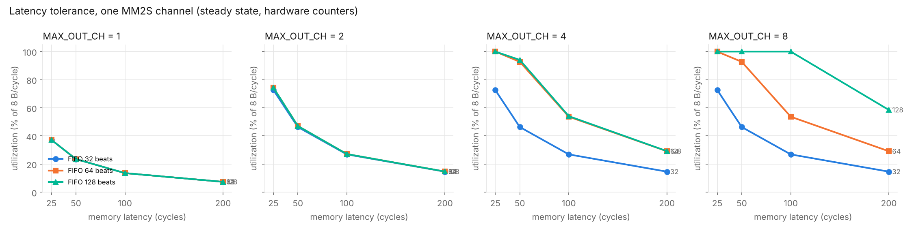

# XDMA results

Generated by `make results` from commit `6907556` on 2026-11-26. Every number below is read from the output of the command named next to it. Simulation: Verilator 5.054 + cocotb 2.1. Formal: SymbiYosys. Synthesis, timing and power: **Yosys + OpenSTA, ASAP7 (RVT, TT, NLDM), post-synthesis** (no place and route, ideal clock). See docs/ENV.md for versions.

## Summary (spec 18)

| Metric | Value | Source |
|---|---|---|
| Channels / data width / max burst | 4 (2 MM2S + 2 S2MM) / 64-bit / 16 beats | parameters (rtl/xdma_top.sv) |
| Outstanding transactions (engine-wide reads) | 16 (MAX_OUT_RD) | parameters |
| Bandwidth utilization at latency 50, defaults | 92.7% | `make perf` (perf_latency, steady state, hardware counters) |
| Bandwidth utilization at latency 200, FIFO 128 | 58.5% | `make perf` |
| TLB hit rate, linear 64 KB transfer | 96.9% (496 hits, 16 misses) | `make perf` (perf_xlat) |
| Achieved clock (Yosys + OpenSTA, ASAP7, post-synthesis) | 1.00 GHz (1000 ps, WNS +46.1 ps) | `make syn` |
| Standard-cell area | 17,025 µm² (clock gating off); 12,776 µm² (clock gating on) | `make syn` (Yosys stat, ASAP7 liberty) |
| Total power at target clock (perf_saturate activity) | 8.69 mW with clock gating, 37.96 mW without | `make syn` (OpenSTA, SAIF) |
| Gate-level simulation | not run | `make gls` |
| RTL bugs found and fixed | 8 (B-001 to B-008; root causes in docs/DECISIONS.md) | docs/DECISIONS.md |
| Regression | default: 3,401/3,401 runs pass (18 tests, up to 200 seeds each); FIFO_DEPTH=32, MAX_OUT_CH=4, MAX_BURST=8: 801/801 runs pass (17 tests, up to 50 seeds each); PREFETCH_EN=0: 801/801 runs pass (17 tests, up to 50 seeds each) | `make regress SEEDS=N` |
| Formal | 12/12 tasks pass: 7/7 unbounded proofs, 5/5 cover sets reached; w_mux proven at reduced size (2 writes in flight, 1-4 beat bursts), full size in simulation | `make formal` |
| Coverage | functional bins 53/53 hit; line 99.8% (100.0% after exclusions), toggle 97.5% (99.9% after exclusions), assertion covers 25/25 | `make cov` |

## Regression

Commands: `make regress SEEDS=200` (default parameters), `python3 tb/regress.py --seeds 50 --params FIFO_DEPTH=32,MAX_OUT_CH=4,MAX_BURST=8 --tag small` and `python3 tb/regress.py --seeds 50 --params PREFETCH_EN=0 --tag noprefetch`. Every run has all assertions bound in; a run passes only with zero assertion failures.

| Test | default | FIFO_DEPTH=32, MAX_OUT_CH=4, MAX_BURST=8 | PREFETCH_EN=0 |
|---|---|---|---|
| test_2d | 200/200 | 50/50 | 50/50 |
| test_abort | 200/200 | 50/50 | 50/50 |
| test_abort_races | 200/200 | 50/50 | 50/50 |
| test_addr_gen | 200/200 | - | - |
| test_all_channels | 200/200 | 50/50 | 50/50 |
| test_axi_errors | 200/200 | 50/50 | 50/50 |
| test_boundary_4k | 200/200 | 50/50 | 50/50 |
| test_chain | 200/200 | 50/50 | 50/50 |
| test_csr | 1/1 | 1/1 | 1/1 |
| test_irq | 200/200 | 50/50 | 50/50 |
| test_loopback_copy | 200/200 | 50/50 | 50/50 |
| test_mm2s_1d | 200/200 | 50/50 | 50/50 |
| test_s2mm_1d | 200/200 | 50/50 | 50/50 |
| test_soak | 200/200 | 50/50 | 50/50 |
| test_stream_len | 200/200 | 50/50 | 50/50 |
| test_tlb_flush | 200/200 | 50/50 | 50/50 |
| test_translate_basic | 200/200 | 50/50 | 50/50 |
| test_translate_fault | 200/200 | 50/50 | 50/50 |

## Formal (SymbiYosys)

Command: `make formal`. `proven` = unbounded proof (k-induction or PDR); covers show each target's interesting behaviour is reachable, so no proof is vacuous.

| Target | Task | Result | Time (s) |
|---|---|---|---|
| addr_gen | prove_b16 | proven (LINE_BYTES 9 bits, LINES 4 bits; addresses and stride 32-bit) | 5.3 |
| addr_gen | prove_b8 | proven (LINE_BYTES 9 bits, LINES 4 bits; addresses and stride 32-bit) | 3.3 |
| addr_gen | cover_b16 | all covers reached | 0.8 |
| fifo | prove_d4 | proven | 2.5 |
| fifo | prove_d5 | proven | 3.5 |
| fifo | cover_d4 | all covers reached | 0.9 |
| rr_arb | prove | proven (N = 4) | 1.2 |
| rr_arb | cover | all covers reached | 0.9 |
| skid | prove | proven | 0.8 |
| skid | cover | all covers reached | 0.8 |
| w_mux | prove | proven (reduced: 2 writes in flight, 1-4 beat bursts; full size covered by the same assertions in simulation) | 4.5 |
| w_mux | cover | all covers reached | 0.9 |

## Performance (spec 16)

Command: `make perf`. Utilization = bytes / (8 B × cycles) in a steady-state window, from the BYTES and BUSY_CYC counters; every point is cross-checked against testbench timestamps (must agree within 1%). Memory model: fixed latency, no throttling.

### Latency tolerance (one MM2S channel, sink always ready)

| MAX_OUT_CH | FIFO (beats) | L=25 | L=50 | L=100 | L=200 |
|---|---|---|---|---|---|
| 1 | 32 | 37.2% | 23.5% | 13.6% | 7.3% |
| 1 | 64 | 37.2% | 23.5% | 13.6% | 7.3% |
| 1 | 128 | 37.2% | 23.5% | 13.6% | 7.3% |
| 2 | 32 | 72.7% | 46.3% | 26.9% | 14.6% |
| 2 | 64 | 74.4% | 47.1% | 27.1% | 14.7% |
| 2 | 128 | 74.4% | 47.1% | 27.1% | 14.7% |
| 4 | 32 | 72.7% | 46.3% | 26.9% | 14.6% |
| 4 | 64 | 100.0% | 92.7% | 53.7% | 29.1% |
| 4 | 128 | 100.0% | 94.1% | 54.1% | 29.2% |
| 8 | 32 | 72.7% | 46.3% | 26.9% | 14.6% |
| 8 | 64 | 100.0% | 92.7% | 53.7% | 29.1% |
| 8 | 128 | 100.0% | 100.0% | 100.0% | 58.5% |

Largest hardware-vs-testbench difference over all 48 points: 0.015%.

Little's law: wherever utilization is below 100%, in_flight_beats / utilization - latency = 18.0 .. 19.7 cycles (mean 18.6), i.e. utilization = in_flight / (latency + ~19) with in_flight = min(FIFO_DEPTH, 16 × MAX_OUT_CH) beats. See docs/DESIGN_WALKTHROUGH.md section 2.

### Burst length (latency 50, FIFO 64, MAX_OUT_CH 8)

| MAX_BURST | Utilization |
|---|---|
| 4 | 57.2% |
| 8 | 100.0% |
| 16 | 92.7% |

### Fairness (all four channels saturating, latency 50)

| Channel | Direction | Share of its direction | Share of all bytes |
|---|---|---|---|
| 0 | MM2S | 50.3% | 25.2% |
| 1 | MM2S | 49.7% | 24.9% |
| 2 | S2MM | 50.0% | 25.0% |
| 3 | S2MM | 50.0% | 25.0% |

### Descriptor overhead (4 KB total, latency 50, end to end)

| Shape | Prefetch | Utilization | Mean gap between descriptors (cycles) |
|---|---|---|---|
| 1x4KB | on | 71.6% | - |
| 64x64B | on | 6.5% | 114 |
| 1x4KB | off | 71.6% | - |
| 64x64B | off | 4.6% | 167 |

The gap with prefetch is the status-writeback round trip plus the first read latency (SPEC.md 7.1, DECISIONS.md D-045); prefetch removes the descriptor-fetch round trip.

### Translation cost (64 KB MM2S, latency 50, end to end)

| Mode | Utilization | TLB hits | TLB misses | Hit rate |
|---|---|---|---|---|
| off | 91.1% | 0 | 0 | - |
| linear | 77.0% | 496 | 16 | 96.9% |
| stride4096 | 36.9% | 192 | 64 | 75.0% |

## Synthesis, timing and power (Yosys + OpenSTA, ASAP7, post-synthesis)

Command: `make syn`. Yosys 0.71 (yosys-slang front end, hierarchy kept, ABC mapping with buffering and gate sizing) onto ASAP7 7.5-track RVT cells, typical corner, NLDM. OpenSTA with an ideal clock, I/O delays 20% of the period, BUFx2 input drive, 4 × BUFx2 output load. Clock sweep from 1000 ps in 50 ps steps, re-synthesizing at each period; the result is the fastest period with WNS >= 0.

| Period (ps) | WNS (ps) | TNS (ps) |
|---|---|---|
| 1000 | +46.1 | 0.0 |
| 950 | -3.9 | -15.5 |

**Fmax: 1.00 GHz (1000 ps).**

### Area per block (clock gating off)

| Block | Area (µm²) | Share |
|---|---|---|
| g_ch[3].g_s2mm.u_wr | 3,581.5 | 21.0% |
| g_ch[2].g_s2mm.u_wr | 3,580.5 | 21.0% |
| g_ch[0].g_mm2s.u_rd | 3,566.4 | 20.9% |
| g_ch[1].g_mm2s.u_rd | 3,566.4 | 20.9% |
| u_csr | 651.1 | 3.8% |
| u_tlb | 343.2 | 2.0% |
| g_ch[0].u_ctl | 318.9 | 1.9% |
| g_ch[1].u_ctl | 318.9 | 1.9% |
| g_ch[3].u_ctl | 318.2 | 1.9% |
| g_ch[2].u_ctl | 318.0 | 1.9% |
| u_w_mux | 204.9 | 1.2% |
| u_ar_arb | 100.8 | 0.6% |
| u_aw_arb | 97.5 | 0.6% |
| u_ptw | 55.2 | 0.3% |
| (top-level glue) | 3.3 | 0.0% |
| **total** | **17,024.8** | 100% |

FIFOs (all xdma_fifo instances: data FIFOs, burst queues, W-order queue): 13,036 µm² = 76.6% of the total.

### Power at the target clock

| Activity | Clock gating | Internal (mW) | Switching (mW) | Leakage (mW) | Total (mW) |
|---|---|---|---|---|---|
| perf_saturate (all channels busy) | off | 34.762 | 3.173 | 0.0236 | 37.959 |
| perf_saturate (all channels busy) | on | 6.187 | 2.490 | 0.0179 | 8.695 |
| idle | off | 29.079 | 0.326 | 0.0235 | 29.429 |
| idle | on | 2.033 | 0.169 | 0.0175 | 2.220 |

Activity: SAIF from RTL simulation (Verilator) of perf_saturate (32 KB per channel) and of 4000 idle cycles, instance names mapped to the netlist; 29,491 pins annotated from the SAIF, the rest (386,890) propagated by OpenSTA. Power numbers are therefore estimates; the clock-gating comparison uses the same activity for both netlists.

### Top 10 timing paths at the final period

Flop instances are mapped back to the RTL register they implement (from the netlist's Q nets).

| # | Startpoint | Endpoint | Slack (ps) |
|---|---|---|---|
| 1 | `g_ch[0].g_mm2s.u_rd/u_ag/out_va[0]` | `g_ch[0].g_mm2s.u_rd/u_ag/line_addr[31]` | +46.1 |
| 2 | `g_ch[1].g_mm2s.u_rd/u_ag/out_va[0]` | `g_ch[1].g_mm2s.u_rd/u_ag/line_addr[31]` | +46.1 |
| 3 | `g_ch[2].g_s2mm.u_wr/u_ag/out_va[0]` | `g_ch[2].g_s2mm.u_wr/u_ag/line_addr[31]` | +46.1 |
| 4 | `g_ch[3].g_s2mm.u_wr/u_ag/out_va[0]` | `g_ch[3].g_s2mm.u_wr/u_ag/line_addr[31]` | +46.1 |
| 5 | `m_axi_bvalid` | `u_csr/\ch_bytes[2] [31]` | +63.2 |
| 6 | `g_ch[0].g_mm2s.u_rd/u_ag/out_va[0]` | `g_ch[0].g_mm2s.u_rd/u_ag/line_addr[30]` | +64.6 |
| 7 | `g_ch[1].g_mm2s.u_rd/u_ag/out_va[0]` | `g_ch[1].g_mm2s.u_rd/u_ag/line_addr[30]` | +64.6 |
| 8 | `g_ch[2].g_s2mm.u_wr/u_ag/out_va[0]` | `g_ch[2].g_s2mm.u_wr/u_ag/line_addr[30]` | +64.6 |
| 9 | `g_ch[3].g_s2mm.u_wr/u_ag/out_va[0]` | `g_ch[3].g_s2mm.u_wr/u_ag/line_addr[30]` | +64.6 |
| 10 | `m_axi_bvalid` | `u_csr/\ch_bytes[2] [30]` | +85.6 |

Explanation: the critical paths are the address generator's burst computation (spec 17.3): from a line-address bit through the 32-bit `line_addr + offset` add, the distance to the next 4 KB boundary and the three-way `min()`, whose result selects whether `line_addr` advances by STRIDE, into the top bits of `line_addr`. One such path per channel. Registering the burst length would remove it at the cost of one cycle per burst.
The `m_axi_bvalid` -> `ch_bytes` path is an S2MM B response (input delay 20% of the period) adding the burst's bytes to the 32-bit BYTES counter.

Full report: `syn/out/timing_paths_final_nocg.rpt` (after `make syn`). Discussion: docs/DESIGN_WALKTHROUGH.md section 10.

## Coverage

Command: `make cov`.

| Coverage | Hit | Total | % |
|---|---|---|---|
| RTL lines | 413 | 414 | 99.8% |
| RTL lines, after exclusions | 413 | 413 | 100.0% |
| RTL toggles | 20745 | 21268 | 97.5% |
| RTL toggles, after exclusions | 20071 | 20090 | 99.9% |
| Assertion cover properties | 25 | 25 | 100.0% |
| Functional bins (spec 14.4) | 53 | 53 | 100.0% |

Runs merged: 275 code-coverage databases, 275 functional-coverage files (default parameters, FIFO_DEPTH=32,MAX_OUT_CH=4,MAX_BURST=8, and PREFETCH_EN=0).

Functional coverpoints:

| Coverpoint | Bins hit | Missing |
|---|---|---|
| burst_len | 16/16 | - |
| split_4k | 1/1 | - |
| lines | 2/2 | - |
| stride | 3/3 | - |
| chain_len | 4/4 | - |
| tlb | 5/5 | - |
| err_code | 7/7 | - |
| abort_state | 3/3 | - |
| active_channels | 4/4 | - |
| ar_conflict | 3/3 | - |
| fifo_full | 2/2 | - |
| outstanding_max | 3/3 | - |

Exclusions (tb/cov_exclusions.txt, each constant by construction or bounded by a parameter):

- toggle `xdma_top.sv` `^m_axis_tkeep\b`: tied to all ones (spec 4)
- toggle `xdma_top.sv` `^m_axi_(wstrb|awcache|arcache|awqos|arqos|awprot|arprot|awlock|arlock|awsize|arsize|awburst|arburst)\b`: fixed AXI attributes (spec 4)
- toggle `xdma_w_mux.sv` `^m_axi_wstrb\b`: WSTRB is always 0xFF (D-044)
- toggle `xdma_csr.sv` `^irq_bits\b`: constant mask of implemented IRQ bits (D-033)
- toggle `xdma_csr.sv` `^irq_set\[(1[2-9]|2[0-9]|3[01]|[4-7])\]`: IRQ bits of channels that do not exist (NUM_CH = 4)
- toggle `*` `^ev_bytes(\[\d+\])?\[(8|9|10|11)\]`: at most 128 bytes per cycle (16 beats x 8 B); 12-bit field sized for MAX_BURST = 256 (D-050)
- toggle `xdma_addr_gen.sv` `^lim\[([5-9]|1[0-3])\]`: min() result is at most MAX_BURST = 16 (field is 14 bits wide for the compare, B-001)
- toggle `*` `^(len|data_len|rd_len|wr_len|aw_len|ar_len|acc_len)(\[\d+\])?\[[4-7]\]`: AXLEN <= MAX_BURST - 1 = 15
- line `xdma_ptw.sv` `^65$`: default branch of a fully decoded state enum (unreachable)
- toggle `*` `^ev_bytes(\[\d+\])?\[[0-2]\]`: byte counts are multiples of 8 (whole beats)
- toggle `xdma_csr.sv` `^ev_bytes\[[01]\]\[([4-7])\]`: MM2S channels count exactly 8 bytes per beat
- toggle `xdma_top.sv` `^ev_bytes\[[01]\]\[([4-7])\]`: MM2S channels count exactly 8 bytes per beat
- toggle `xdma_rd_chan.sv` `^ev_bytes\[[4-7]\]`: MM2S counts exactly 8 bytes per beat
- toggle `*` `^s_axil_[br]resp\b`: AXI4-Lite responses are always OKAY (spec 5)
- toggle `xdma_csr.sv` `^ar_word\[[01]\]`: word-aligned register decode (B-002): bits [1:0] are 0
- toggle `*` `^(acc_id|id|aw_id|aw_acc_id|m_axi_awid)\[3\]`: AW IDs are 2..7; only the walker's AR uses ID 8
- toggle `*` `^(wb_addr|aw_addr)(\[\d+\])?\[[0-4]\]`: status writeback address = 32-byte-aligned descriptor + 0x18: bits [4:0] are constant
- toggle `*` `^(walk_addr|ar_addr|ptw_ar_addr)\[[0-2]\]`: PTE reads are aligned 8-byte words: bits [2:0] are 0

Toggle bits still never toggled (after exclusions), grouped:

- `xdma_top.sv` `wb_data[*][*]`: 4
- `xdma_top.sv` `g_ch[*].dp_err_code[*]`: 4
- `xdma_w_mux.sv` `wb_data[*][*]`: 4
- `xdma_tlb.sv` `e_w[*]`: 2
- `xdma_tlb.sv` `m_ppn[*]`: 2
- `xdma_desc_fetch.sv` `wb_data[*]`: 1
- `xdma_rd_chan.sv` `dp_err_code[*]`: 1
- `xdma_wr_chan.sv` `dp_err_code[*]`: 1

